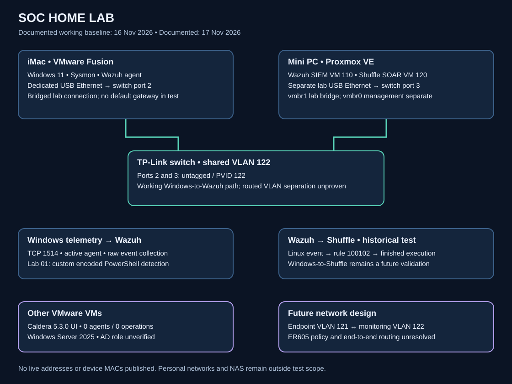

# SOC Home Lab | Detection Engineering & Security Automation

**Personal project · Ongoing development**

I'm building a home Security Operations Centre to develop practical skills in endpoint monitoring, detection engineering, security automation and network troubleshooting. This repository documents my implementation, test results, technical decisions and lessons learned.

My environment combines **Proxmox VE**, **VMware Fusion**, **Wazuh**, **Sysmon**, **Shuffle SOAR** and **MITRE Caldera**. I've validated a Windows PowerShell detection and a separate Linux-event-to-SOAR workflow. My next goal is to connect these foundations into a controlled end-to-end emulation and investigation exercise.

## Featured work

| Case study | What I implemented | Recorded result |
|---|---|---|
| **[01 — Detecting encoded PowerShell](labs/01-encoded-powershell-detection/README.md)** | Sysmon process telemetry and custom Wazuh rule `100101`, extending built-in rule `92057` | Two level-13 alerts from a harmless positive test; 3 Nov 2026 |
| **[02 — Testing a SOAR webhook](labs/02-shuffle-webhook-test/README.md)** | A Shuffle workflow, synthetic Wazuh-shaped JSON and offline Docker dependency troubleshooting | Workflow reached `FINISHED`; 7 Nov 2026 |
| **[03 — Automating a live alert](labs/03-live-wazuh-shuffle-automation/README.md)** | Real Linux journal event → Wazuh rule `100102` → Shuffle integration | Automatic forwarding and completed workflow; 9 Nov 2026 |

[View the detection result](labs/01-encoded-powershell-detection/evidence/24-custom-rule-100101-success.png) · [View the live automation result](labs/03-live-wazuh-shuffle-automation/docs/screenshots/shuffle-finished-execution.png)

## Environment

| VM | Host | Role | Latest documented result |
|---|---|---|---|
| Wazuh SIEM — VM 110 | Proxmox / mini PC | Manager, indexer and dashboard | Windows ingestion and custom detection tests |
| Shuffle SOAR — VM 120 | Proxmox / mini PC | Webhooks and workflow automation | Live Linux-event automation |
| Windows 11 — `WIN11-SOC` | VMware Fusion / iMac | Sysmon and Wazuh endpoint | Active agent and event collection on 16 Nov |
| MITRE Caldera | VMware Fusion / iMac | Future adversary-emulation testing | 5.3.0 dashboard captured; 0 agents and 0 operations |
| Windows Server 2025 | VMware Fusion / iMac | Planned AD DS and DNS exercises | Desktop Experience installation recorded; domain role not yet validated |

The network baseline documented here is my **16 November 2026 shared-VLAN Windows-to-Wazuh test**. Routed segmentation and the other unfinished milestones are tracked separately; these pages describe dated results rather than live service health.

[Full hardware and VM inventory](architecture/inventory.md) · [Current architecture](architecture/current/README.md) · [Planned segmentation](architecture/planned-design/README.md)

## Engineering decisions and lessons

- **Trace the signal before tuning the rule.** I checked local Sysmon events, agent collection, Wazuh decoding and parent-rule matches to locate detection problems.
- **Validate each stage independently.** A reachable webhook, matching rule and finished workflow establish different parts of the pipeline.
- **Separate network diagnosis from the final design.** Shared VLAN 122 restored local Windows-to-Wazuh connectivity; controlled routing between VLANs remains a separate objective.
- **Investigate successful exits as well as errors.** A zero-byte Shuffle app script caused containers to exit with code 0 without processing work.

[Engineering notes](docs/engineering-notes.md) · [Troubleshooting](docs/troubleshooting.md)

## Reproduction and supporting material

The [numbered build guides](docs/build-guide/README.md) cover the host setup, networking, platform installation, telemetry, detections and automation. They are reproduction procedures; the case studies identify what I actually validated.

| Location | Contents |
|---|---|
| `architecture/` | Hardware/VM inventory, topology and intended network policy |
| `docs/build-guide/` | Numbered installation, configuration and verification guides |
| `platforms/` | Platform roles, configuration references and Caldera dashboard evidence |
| `labs/` | Case studies, detection rules, harmless tests and reviewed screenshots |
| `configs/` | Configuration examples with placeholder values |
| `templates/new-exercise/` | Consistent structure for future experiments |
| `scripts/` | Documentation and publication checks |

## Next milestones

I'm working towards stronger negative testing, a validated Windows-alert-to-Shuffle path, routed lab segmentation and a benign Caldera operation correlated with Wazuh telemetry. Lab 01's negative test has not yet been documented as executed. I have not yet demonstrated a Caldera operation or a Caldera-generated Wazuh detection.

[Roadmap](docs/roadmap.md) · [Project history](docs/source-map.md) · [Changelog](CHANGELOG.md) · [Documentation conventions](CONTRIBUTING.md)

All exercises concern authorised lab systems. Public examples use placeholders, and only selected reviewed screenshots are included. Credentials, operational addressing and raw logs remain private. [Security and evidence policy](SECURITY.md).
