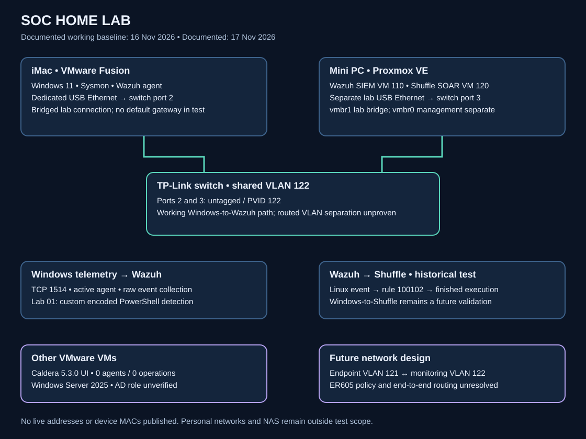

# Current documented architecture

[Home](../../README.md) · [Inventory](../inventory.md) · [Network policy](../network-policy.md)

I validated the **Windows-to-Wazuh connection on shared VLAN 122 on 16 November 2026**. This page records that baseline. My earlier ER605 experiments did not establish an end-to-end Windows-side routed connection and do not supersede this dated result. See [network history](../../docs/network-history.md).

## Physical and virtual connections

| Connection | Function | Observed configuration |
|---|---|---|
| iMac dedicated USB Ethernet → switch port 2 | VMware Windows lab connection | VLAN 122 untagged; PVID 122 |
| Proxmox separate USB Ethernet → switch port 3 | `vmbr1` physical lab connection | VLAN 122 untagged; PVID 122 |
| Proxmox built-in Ethernet → management connection | `vmbr0`, host administration | Kept separate from lab bridge; real address omitted |
| Switch port 4 | Temporary switch administration | VLAN 1 untagged; 121/122 tagged; PVID 1 in recorded setup |
| Switch port 5 | Unused in recorded setup | VLAN 1 untagged; 121/122 tagged; PVID 1 in recorded setup |

VLAN 121 existed but was not the Windows access VLAN during the successful shared-VLAN test. Two access ports in one VLAN prove local connectivity, not inter-VLAN routing. Complete home-network isolation still requires explicit validation.

## Verified paths

| Path | Recorded observation |
|---|---|
| Windows → Wazuh | Ping replies and TCP 1514 succeeded |
| Wazuh Windows agent | Registered and Active (`WIN11-SOC`, agent 001) |
| Windows browser → Wazuh dashboard | Accessible |
| Windows Application Event 101 → Wazuh archive | Raw collection verified; custom alert not demonstrated |
| Sysmon process event → Wazuh archive | Raw collection verified |
| Wazuh → Shuffle | Earlier Linux-event automation validated 9 Nov; not revalidated as a Windows pipeline |
| Caldera UI | Dashboard recorded 16 Nov; network placement unverified |

## Other VM placement

Wazuh and Shuffle run on Proxmox; Windows 11, Caldera and Windows Server 2025 are recorded on VMware Fusion. Caldera and Windows Server are shown separately because their attachment to the working VLAN has not been validated.

## Management boundaries

My network notes record a host input drop rule on the SOC-facing bridge. Management protection remains part of the intended design. Complete isolation still needs routing, forwarding and firewall review plus tests of both permitted and denied flows; an unsuccessful ping alone is insufficient.

## Reproduction and planned changes

The [network setup](../../docs/build-guide/02-networking.md), [VMware setup](../../docs/build-guide/03-vmware.md) and [validation guide](../../docs/build-guide/11-validation.md) describe reproduction. My [planned design](../planned-design/README.md) covers the next segmentation milestone.
