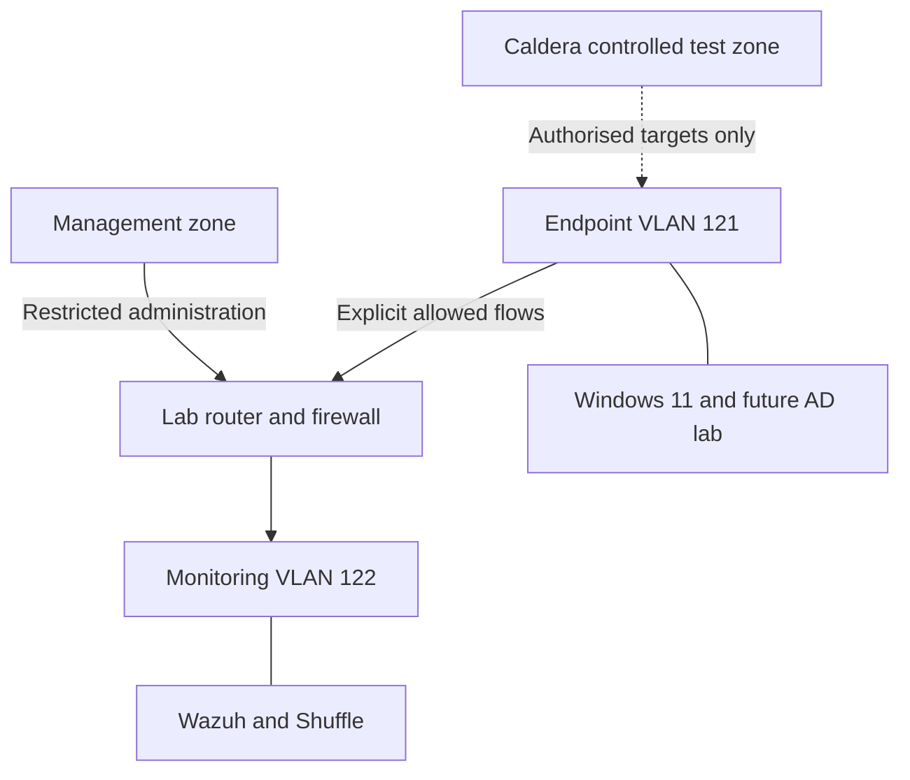

# Planned segmented architecture

[Home](../../README.md) · [Current baseline](../current/README.md)

My target is policy-controlled separation between endpoint and monitoring zones. I plan to replace the temporary shared-VLAN baseline after router attachment, gateway configuration and explicit allow/deny tests are validated.

| Component | Intended role | Completion condition |
|---|---|---|
| ER605 or equivalent router/firewall | Enforce routes and policy between lab zones | Both physical/VLAN links verified; intended flows permitted and others denied |
| Windows 11 | Endpoint VLAN 121 | Active Wazuh connection across routed policy |
| Wazuh and Shuffle | Monitoring VLAN 122 | Telemetry and webhook delivery verified with narrowly scoped rules |
| Windows Server 2025 | Future domain controller / DNS | AD DS promotion, domain joins, DNS and audit tests recorded |
| Caldera | Approved disposable endpoint testing | Placement, enrolled agent and benign operation documented |
| Home devices / NAS | Outside test scope | Denied access from lab according to tested policy |

Do not enable a gateway on a VM until routing and policy are deliberate. My ER605 tests established only partial connectivity, not end-to-end endpoint/server routing. Exact live addresses are private. [Network policy](../network-policy.md) lists service requirements.
