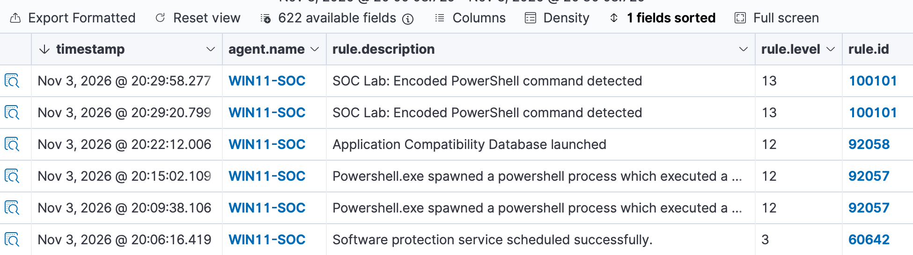

# Lab 01 — Detecting encoded PowerShell with Wazuh

[Project home](../../README.md) · [Reproduction guide](../../docs/build-guide/07-detection.md)

**Validated:** 3 November 2026 · **Focus:** Windows telemetry and custom detection logic.

## Objective

I wanted to trace a harmless PowerShell execution from the Windows endpoint into Wazuh and validate a custom detection against the observed Sysmon event.

## Environment

| Component | Lab configuration at validation |
|---|---|
| Endpoint | Windows 11 Pro on VMware Fusion; `WIN11-SOC`; 2 vCPU / 6 GB RAM |
| Telemetry | Sysmon Operational channel; Event ID 1, process creation |
| SIEM / agent | Wazuh 4.14.9; Windows agent ID `001` |
| Built-in rule | `92057`, level 12 |
| Custom rule | `100101`, level 13 |
| ATT&CK mapping | `T1059.001` — PowerShell |

## My approach

1. I verified the agent connection and checked Sysmon process events locally.
2. I configured the agent to collect `Microsoft-Windows-Sysmon/Operational` and inspected the decoded Wazuh event.
3. I ran a harmless encoded command that prints `SOC-LAB-ENCODED-TEST`.
4. The built-in rule `92057` fired, but my initial custom rule did not. I investigated filters, decoding context and rule hierarchy.
5. I made the final custom rule a child of the confirmed parent rule, using `<if_sid>92057</if_sid>` and the encoded-command condition.
6. I reloaded the manager and repeated the benign test.

The working path was **Windows → Sysmon Event 1 → Wazuh agent → manager → custom alert**. Caldera and Shuffle were not involved in this exercise.

## Result

The dashboard showed two custom matches at **20:29:20.799** and **20:29:58.277** on 3 November 2026. Both were rule `100101`, level 13.

| Test | Expected result | Observed result |
|---|---|---|
| Benign encoded command matching the parent rule and custom condition | Custom alert `100101` | Two matches recorded |
| Ordinary PowerShell without the encoded flag | No custom match | Negative test included; execution not yet documented |

## What I learned

A valid rule file is not enough to establish that a detection will match a real event. I had to verify collection, the event's decoding context and the branch of the built-in rule hierarchy it reached. A synthetic JSON Logtest input did not reproduce the live Windows event-channel context.

I also learned to distinguish missing search results from missing collection: time ranges, unapplied filters and incomplete queries affected what I could see.

[Detailed troubleshooting timeline](TROUBLESHOOTING.md)

## Reproduce the test

The [numbered guide](../../docs/build-guide/07-detection.md) covers rule installation, configuration validation, manager reload, the harmless positive test and proposed negative test. Prerequisites are in the [Windows telemetry guide](../../docs/build-guide/05-windows-telemetry.md).

| File | Purpose |
|---|---|
| [Detection rule](detections/soc_lab_rules.xml) | Final child rule using parent `92057` |
| [Positive test](tests/encoded_powershell_positive.ps1) | Encoded command that prints a harmless marker |
| [Negative test](tests/negative_test.ps1) | Proposed ordinary PowerShell comparison |
| [Evidence index](EVIDENCE_INDEX.md) | Selected public result evidence |

## Limitations and next iteration

This is a narrow extension of rule `92057`, not a standalone detector for all encoded PowerShell. The initial mismatch's single root cause was not conclusively isolated. Negative testing and false-positive assessment remain open, as do tests of additional command-line patterns.

My next iteration is to run and record the negative case, inspect the matched process/parent fields, and characterise the detector's actual coverage.
