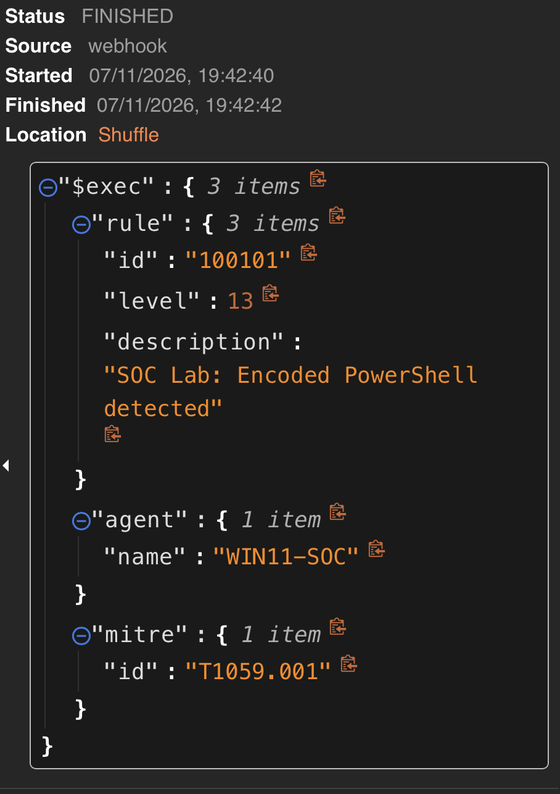

# Lab 02 — Building and testing a Shuffle webhook workflow

[Project home](../../README.md) · [Reproduction guide](../../docs/build-guide/08-shuffle.md)

**Validated:** 7 November 2026 · **Focus:** SOAR workflow execution and offline runtime troubleshooting.

## Objective

I built a small Shuffle workflow to receive a synthetic Wazuh-shaped alert and pass it to an automated action. I tested the webhook path before adding automatic Wazuh forwarding.

## Environment and scope

| Component | Role |
|---|---|
| Proxmox-hosted Ubuntu VM | Self-hosted Shuffle and Docker runtime |
| Shuffle Webhook | Receives the manually submitted JSON payload |
| Shuffle Tools 1.2.0 | `Repeat back to me` action |
| iMac | Management, including an SSH-tunnel path |
| Sample alert | Harmless rule `100101` payload labelled `WIN11-SOC`, technique `T1059.001` |

The VM was kept without general outbound internet access during this work. Required app/worker images were transferred through a controlled staging process. Complete network segmentation is assessed separately in the [architecture documentation](../../architecture/current/README.md).

## My approach

1. I connected a Webhook trigger to a Shuffle Tools action, configured its execution input (`$exec` in this test), selected the starting action and started the trigger.
2. I submitted the [synthetic JSON](examples/simulated-wazuh-alert.json) using the [test script](scripts/send-test-alert.sh).
3. I checked both the HTTP response and the workflow execution rather than treating HTTP acceptance as a completed action.
4. When execution stalled, I inspected worker/app images and the migrated configuration.

The test path was **manual JSON POST → Shuffle webhook → Shuffle Tools → finished workflow**. It did not depend on a live Wazuh alert.

## Troubleshooting and resolution

After moving Shuffle from VMware Fusion to Proxmox, I corrected old hostname references in private configuration and distinguished the iMac's SSH-tunnel port from the VM's service listener.

Offline runtime dependencies required image transfer using `docker save`, `scp` and `docker load`. A particularly useful finding was an app image with a **zero-byte `/app/app.py`**: tasks exited with code 0 without doing useful work. I rebuilt the app image from the matching source, verified the non-empty script and repeated the test.

[Symptoms, findings and diagnostic commands](docs/troubleshooting.md) · [Migration and offline-image procedure](../../docs/migration-and-offline-images.md)

## Result

| Check | Recorded result |
|---|---|
| Webhook response | HTTP `200 OK` |
| Workflow status | `FINISHED` |
| Payload context | Rule `100101`, endpoint label `WIN11-SOC`, technique `T1059.001` |
| UI start / finish | 7 Nov 2026, 19:42:40 / 19:42:42 |
| Separate action-level `SUCCESS` capture | Not recorded in the selected evidence |

## What I learned

Webhook reachability and workflow completion are separate checks. A correctly wired workflow still depends on a starting action, a working worker/app runtime and accurate environment settings. A container's successful exit code can also conceal an empty or ineffective application.

## Reproduction and next iteration

The [Shuffle guide](../../docs/build-guide/08-shuffle.md) covers installation, workflow wiring, privately supplying the hook and testing from the repository. Public examples contain no live webhook identifier.

I subsequently validated automatic forwarding of a real Linux event in [Lab 03](../03-live-wazuh-shuffle-automation/README.md). Windows-originated detection forwarding, richer triage and failure-handling are separate follow-up exercises.
