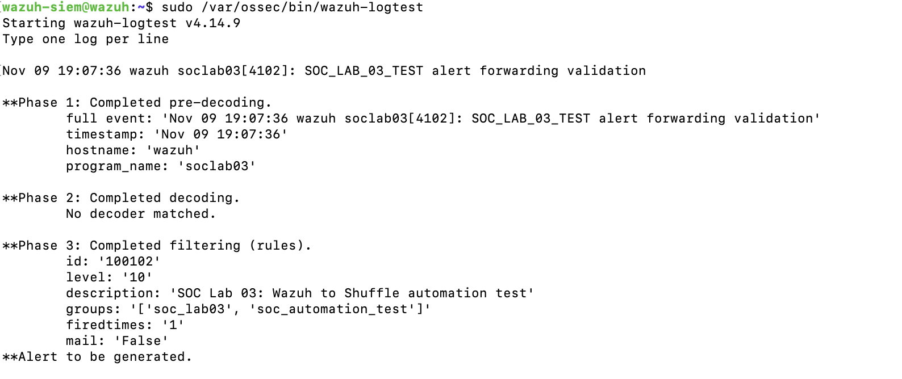
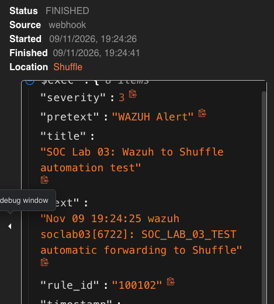
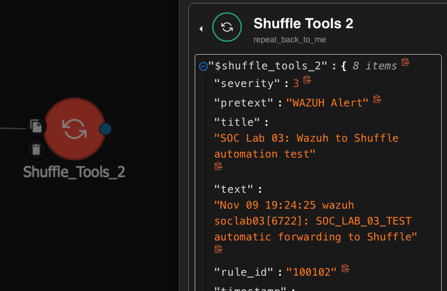

# Lab 03 — Forwarding a live Wazuh alert into Shuffle

[Project home](../../README.md) · [Reproduction guide](../../docs/build-guide/09-live-automation.md)

**Validated:** 9 November 2026 · **Focus:** automatic SIEM-to-SOAR delivery.

## Objective

After testing a manually submitted payload in Lab 02, I wanted to verify that a real event could trigger a Wazuh rule and reach Shuffle automatically.

I used a harmless Linux journal marker for this exercise. The Windows endpoint was disconnected at the time, so this test did not validate Windows-to-Shuffle delivery.

## Environment

| Component | Role in this test |
|---|---|
| Proxmox / Ubuntu | Hosts the Wazuh and Shuffle VMs |
| Wazuh Manager | Collects the journal event, applies rule `100102` and dispatches the alert |
| Shuffle | Receives the webhook and executes `Repeat back to me` |
| Windows 11 | Not used in this exercise |

## My approach

1. I created a dedicated [rule `100102`](rules/soc_lab03_rules.xml) for program `soclab03` and marker `SOC_LAB_03_TEST`, preserving the earlier PowerShell rule.
2. I used `wazuh-logtest` to verify the rule matched at level 10.
3. I configured Wazuh's Shuffle integration with selected rule IDs and JSON alert format, keeping the real hook in private configuration.
4. I validated the manager configuration and generated a live event on the Ubuntu VM:

```bash
logger -t soclab03 'SOC_LAB_03_TEST automatic forwarding to Shuffle'
```

5. I inspected the resulting Shuffle execution and its action output.

The path was **Linux journal event → Wazuh collection → rule `100102` → integration → Shuffle webhook → action output → `FINISHED`**.

## Results

### Rule match



Logtest established the rule match. It did not itself dispatch the integration alert; the live `logger` event tested that path.

### Completed execution



### Returned event fields



The execution ran from approximately **19:24:26 to 19:24:41** in the displayed local time. The Wazuh alert level was **10**. The `severity: 3` field in the returned action payload was a separate output field, not the Wazuh rule level.

## What I learned

A matching test event and a completed integration require different validation. I first tested the rule in isolation, then used a real event to verify collection and automatic delivery. Separating the Linux marker from the Windows detection also made the scope clear while endpoint connectivity was being resolved.

## Reproduction and limitations

The [live automation guide](../../docs/build-guide/09-live-automation.md) contains rule deployment, the single-line Logtest sample, journald collection, integration configuration and the live test. [Public configuration examples](../../configs/wazuh/shuffle-integration.example.xml) use a dummy hook.

This result validates automatic forwarding and a basic action, not enrichment, case creation or containment. A later [16 November connectivity test](../../architecture/current/README.md) verified Windows ingestion on shared VLAN 122, but Windows-to-Shuffle delivery still needs its own end-to-end test.

My next iterations are Windows alert forwarding, triage branching on rule fields, and a useful investigation summary.
