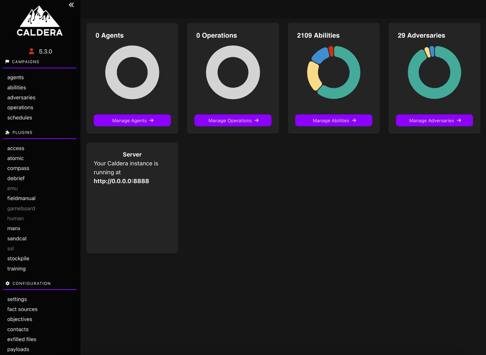
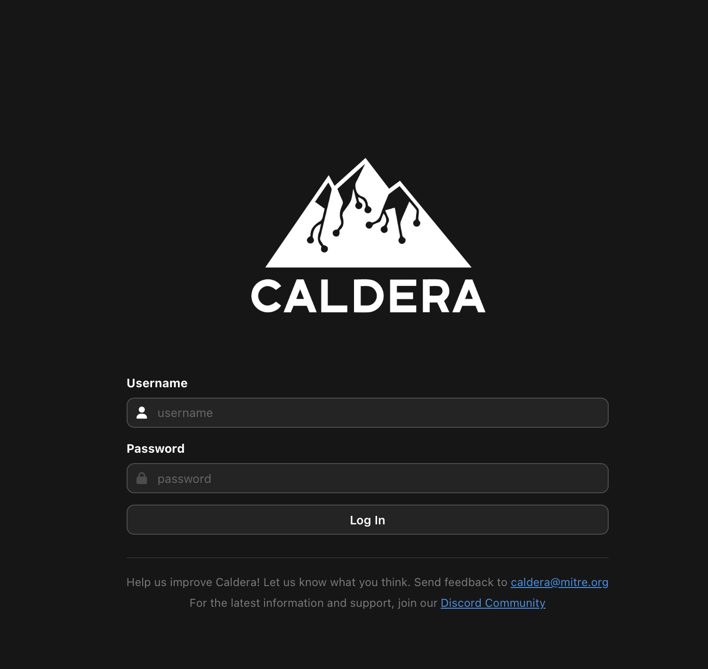

# MITRE Caldera — Emulation platform

[Project home](../../README.md) · [Installation guide](INSTALLATION.md) · [Evidence](evidence/README.md)

## Role in my lab

I have Caldera running as a VMware Fusion VM on the iMac to support future controlled detection tests. My recorded dashboard shows **version 5.3.0**. At this stage I have documented platform access, not a completed adversary-emulation exercise.

## Recorded dashboard — 16 November 2026

| Dashboard field | Recorded value |
|---|---|
| Version | 5.3.0 |
| Agents | 0 |
| Operations | 0 |
| Abilities | 2109 |
| Adversaries | 29 |
| Server bind address | `http://0.0.0.0:8888` |

`0.0.0.0` is the wildcard listening address, not a host address for a client connection. The installation guide uses localhost or a private lab-address placeholder.

## Installation reference

The [Ubuntu installation guide](INSTALLATION.md) describes a repeatable deployment using the 5.3.0 documentation, plugin submodules, a Python virtual environment and the UI build step. It is a reproduction reference rather than a retained command-by-command installation record.

## Next experiment

I plan to enroll one disposable authorised endpoint, run a benign ability and correlate the resulting Sysmon telemetry with Wazuh. Agent connectivity, operations, Wazuh detections caused by Caldera and network-isolation tests are not yet validated in this record.

The completed operation will receive its own numbered case study. Caldera credentials, server configuration, agent keys and payload URLs remain private.

## References

- [Caldera 5.3.0 installation](https://caldera.readthedocs.io/en/v5.3.0/Installing-Caldera.html)
- [Server configuration](https://caldera.readthedocs.io/en/5.3.0/Server-Configuration.html)
- [Troubleshooting](https://caldera.readthedocs.io/en/5.3.0/Troubleshooting.html)
